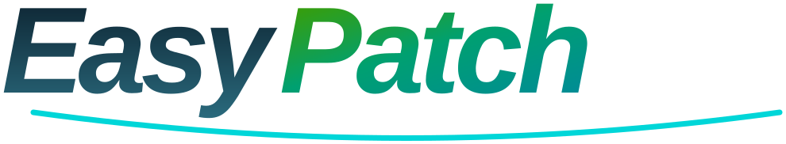

  

<h1 align="center">
  <picture>
    <source media="(prefers-color-scheme: dark)" srcset="frontend/public/wordmark.svg">
    
  </picture>
</h1>

## EasyPatch has moved into EasyRMM

EasyPatch is now part of **EasyRMM**, and is developed in EasyRMM's repository:

### → [github.com/paulmataruso/EasyRMM](https://github.com/paulmataruso/EasyRMM)

EasyPatch's code is in its [`easypatch/`](https://github.com/paulmataruso/EasyRMM/tree/main/easypatch) folder there.

* **New versions, issues and pull requests** go to EasyRMM's repository.
  EasyPatch's releases there are tagged `easypatch-v*`.
* **Installing or upgrading:** follow EasyPatch's
  [installation guide](https://github.com/paulmataruso/EasyRMM/blob/main/easypatch/docs/installation.md).
* **Security reports:** see EasyPatch's
  [security policy](https://github.com/paulmataruso/EasyRMM/blob/main/easypatch/SECURITY.md).
* **This repository is no longer updated.** Its code is EasyPatch as of 1.10.0.
  Its [releases](https://github.com/paulmataruso/EasyPatch/releases), 1.10.0 and
  earlier, and their downloads stay here, so existing installations and links
  keep working.
* **The licence is unchanged:** EasyPatch is source-available under the
  Functional Source License, Version 1.1, ALv2 Future License
  ([LICENSE.md](LICENSE.md)); the licensor is DHI Technical Services LLC.
