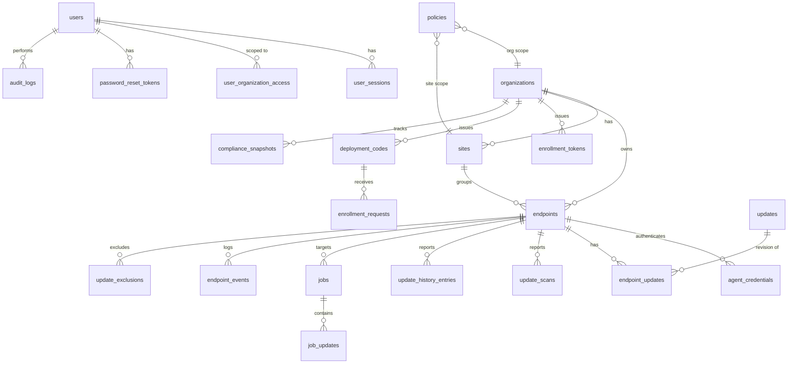

# EasyPatch Architecture

EasyPatch is a self-hosted Windows patch management platform for Managed Service Providers.
It has two parts:

1. **The server**: a Docker Compose stack in a DMZ, reachable on TCP 443.
2. **The agent**: a Windows service (`EasyPatchAgent`) on each managed endpoint. It only makes
   outbound HTTPS connections, so customer networks need no VPN, inbound rules or port
   forwarding. It works behind NAT and CGNAT.

The platform patches the Windows operating system and does nothing else. The agent has no
remote shell and no arbitrary command execution. It never reboots a machine on its own.

## 1. Component overview

```
                     Internet (TCP 443 only)
 ┌──────────────┐        │
 │ Windows agent├──HTTPS─┤      ┌───────────────────────── Docker host (DMZ) ─────────────────────────┐
 │ (LocalSystem)│        │      │  edge network                     data network (internal: no egress)│
 └──────────────┘        ├──────┼─► caddy ──/api,/downloads──► api ─────────────┐                      │
 ┌──────────────┐        │      │     │  (TLS, headers,              │  ▲         ▼                      │
 │ Admin browser├──HTTPS─┘      │     │   static SPA)                │  │     postgres (volume)          │
 └──────────────┘               │     └─ / (SPA files)               │  │         ▲                      │
                                │                          worker ───┘  └─migrate─┘                      │
                                └──────────────────────────────────────────────────────────────────────┘
```

| Container | Image | Purpose |
|---|---|---|
| `caddy` | `easypatch-proxy` (Caddy plus the built SPA) | Terminates TLS with automatic ACME certificates, enforces TLS 1.2+, adds security headers, serves the React SPA and reverse-proxies `/api/*` and `/downloads/*` to the API. |
| `api` | `easypatch-server` | ASP.NET Core 10 Web API. Handles admin auth, the admin REST API, the agent protocol and OpenAPI. |
| `worker` | `easypatch-server` (different entrypoint) | Background processing: job expiry and lease recovery, online/offline detection, scheduled installs, compliance snapshots, retention. |
| `postgres` | `postgres:18.6-alpine3.24` | System of record, including the durable job queue. Attached only to the internal `data` network. |
| `migrate` | `easypatch-server` | One-shot container that applies EF Core migrations before `api` and `worker` start. |

The SPA is served by Caddy, not by a separate frontend container. That was a deliberate
change from the original spec: a fifth container would have added nothing.

### Solution layout

```
shared/EasyPatch.Contracts      Wire DTOs, enums, request signing, update classifier (net10.0, no deps)
backend/Core                    Domain entities and pure domain logic (reconciliation, compliance, policy, lifecycle)
backend/Infrastructure          EF Core DbContext, migrations, application services
backend/API                     ASP.NET Core host: controllers, authentication, rate limiting, CLI commands
backend/Worker                  Background services host
backend/Tests                   Unit and integration tests (Testcontainers PostgreSQL)
agent/EasyPatch.Agent.Core      Platform-independent agent logic (scheduler, jobs, outbox, state)
agent/EasyPatch.Communication   Signed HTTPS client for the agent protocol
agent/EasyPatch.WindowsUpdate   Windows Update Agent (WUA) COM integration          [Windows]
agent/EasyPatch.Inventory       WMI and registry inventory, reboot and update-source detection [Windows]
agent/EasyPatch.Agent           Windows service host, DPAPI, CLI                     [Windows]
agent/EasyPatch.Agent.Tests     Agent logic tests (run on any OS using fakes)
agent/Installer                 WiX v5 MSI project
frontend/                       React + TypeScript + Vite + Tailwind SPA
```

`EasyPatch.Contracts` is shared by the agent and the server. Both sides therefore serialize
identical DTOs, compute identical request signatures and classify updates the same way.

## 2. Domain model

Organizations contain sites, and sites contain endpoints. Every endpoint belongs to exactly
one organization and to at most one site. Each organization and site has a time zone, which
is used for maintenance windows.

### Entity relationship design



| Table | Key columns / notes |
|---|---|
| `users` | username, email, Argon2id `password_hash`, `role` (SuperAdmin, Admin, ReadOnly), MFA secret (protected with ASP.NET Data Protection), recovery code hashes, lockout counters, `security_stamp` |
| `user_sessions` | SHA-256 of the session token, MFA-completed flag, idle and absolute expiry, `revoked_at` |
| `user_organization_access` | When a non-SuperAdmin user has rows here, they can only see those organizations. Enforced now; the UI to manage it can come later. |
| `password_reset_tokens` | Hashed, single-use, expiring tokens issued by an administrator |
| `organizations`, `sites` | `is_active` and `archived_at`. Archiving is preferred to deleting; hard delete is only allowed when no endpoints exist. |
| `endpoints` | Identity, OS and hardware inventory, agent version, check-in, scan and inventory timestamps, reboot state and reasons, update source, OS support status, and denormalized compliance counters |
| `agent_credentials` | Public ID `c_…`, ECDSA P-256 **public key only**, expiry, revocation, `replaced_by` |
| `enrollment_tokens` | SHA-256 hash, display prefix, org (and optional site) scope, `max_uses` (default 1), `use_count`, expiry, revocation |
| `deployment_codes` | Non-secret code for tokenless (RMM) installs. Org and optional site scope, cap on pending requests, optional source CIDR allow-list, revocation |
| `enrollment_requests` | Pending tokenless enrollments: public key, fingerprint, reported device identity, source IP, status (Pending, Approved, Rejected, Expired) |
| `updates` | Update catalog keyed by (`update_guid`, `revision_number`). Holds KBs, title, description, MS classification, normalized category, products, severity, `last_deployment_change_time`, size, reboot behavior, superseded IDs |
| `endpoint_updates` | Per-endpoint state, unique by (`endpoint_id`, `update_guid`) so a revision bump never duplicates a row. Holds `state`, `is_required`, `is_excluded`, error code and message, timestamps |
| `update_scans` | One row per scan report. `agent_scan_id` is unique per endpoint, which makes ingestion idempotent |
| `update_history_entries` | Windows Update history (installs and uninstalls with result and HRESULT), deduplicated by fingerprint |
| `update_exclusions` | Per-endpoint excluded updates (by GUID). Organization and site exclusions live in policy as KB lists. |
| `jobs` | Durable job queue. Holds lease and delivery tracking, payload and result (`jsonb`), progress, sequence number, dedupe key (partial unique index over active jobs), and an `xmin` concurrency token |
| `job_updates` | Per-update results inside an install job |
| `policies` | One global row plus optional organization and site rows. Nullable fields override the level above. |
| `server_settings` | A single `jsonb` row for global limits, retention periods and credential lifetimes |
| `os_lifecycle_entries` | Editable lifecycle table (product, edition class, build, end of servicing) used for support status |
| `endpoint_events` | Per-endpoint activity (scans, jobs, enrollment, reboot changes, online and offline transitions) |
| `audit_logs` | Every administrative action, with user, IP and correlation ID |
| `compliance_snapshots` | Daily per-organization counters for trend reporting |

### Update state model (two layers)

The **endpoint layer** (`endpoint_updates.state`) records what is true on the machine. It is
only changed by scans and final install results:

| State | Meaning |
|---|---|
| `Missing` | Applicable and not installed, according to the latest scan |
| `Failed` | Missing, and the last install attempt failed. The error is kept. |
| `PendingVerification` | The agent reported a successful install and the next scan has not confirmed it yet |
| `PendingReboot` | Installed, but Windows needs a restart to finish (WUA reports `RebootRequired`) |
| `Installed` | A scan reported it as installed. This is the only path to `Installed`. |
| `Superseded` | Replaced by another applicable update, inferred from `SupersededUpdateIDs` |
| `NotApplicable` | Previously reported, now absent from both scan lists and not superseded |
| `Excluded` | Excluded by an administrator (per endpoint) or by a policy KB list |

The **job layer** (`job_updates.status`) records operational progress: `Pending`,
`Downloading`, `Downloaded`, `Installing`, `Succeeded`, `Failed`, `Skipped` (with a reason)
and `Cancelled`. The UI overlays live job progress onto the endpoint inventory. A crashed job
therefore can never leave the inventory stuck in "Downloading".

`is_required` is true when policy says the update should be installed: its category is
allowed, it is not optional (unless optional updates are enabled) and it is not excluded.
Compliance only counts updates where `is_required` is true.

### Update categories

The categories come from `EasyPatch.Contracts.Updates.UpdateClassifier`, in this priority
order:

1. **Driver**: WUA `Type == Driver`, or the Drivers classification
2. **Feature**: the Upgrades classification, or a title starting with "Feature update to"
3. **Definition**: the Definition Updates classification
4. **ServicingStack**: the title contains "Servicing Stack Update"
5. **DotNet**: the title or product contains ".NET Framework" or ".NET"
6. **Cumulative**: the title contains "Cumulative Update"
7. **Security**: the Security Updates classification
8. **Critical**: the Critical Updates classification
9. **Other**: everything else

The original Microsoft classification is stored as well. Cumulative, ServicingStack and
DotNet are derived categories, not Microsoft classifications.

## 3. Policy

The effective policy is resolved in the order **global → organization → site**. Scalar
fields take the most specific non-null value. Lists (excluded KBs) are merged.

| Field | Global default |
|---|---|
| Check-in interval | 60 s (15 s while a job is active) |
| Scan interval | 360 min |
| Inventory interval | 1440 min |
| Jitter | ±10 % |
| Allowed categories | All except Driver and Feature |
| Include optional (BrowseOnly) updates | false |
| Excluded KBs | none |
| Accept EULAs | true |
| Auto-install | **false** |
| Maintenance window | none (days of week, start time, duration, in the site's or organization's time zone) |
| Scan considered stale after | 48 h |
| Max concurrent installs per site | 10 |

Global limits are stored in `server_settings`. The global max concurrent installs defaults
to 50.

## 4. Job system

Job types are `UpdateScan`, `InstallUpdates` and `InventoryRefresh`.

```
Queued ──lease──► Delivered ──ack──► Acknowledged ──► Running ──► Completed
   │                 │ lease expiry                       ├─────► Failed
   │                 └──► Queued (redelivery, max 5)      ├─────► Cancelled
   ├──► Cancelled (admin)                                 └─────► WaitingForReboot ──(after reboot)──► Running
   └──► Expired (not delivered before expires_at)
```

* **Persistence.** All job state lives in PostgreSQL, and nothing is held only in memory.
  The agent also stores the job it is working on in `C:\ProgramData\EasyPatch\state`.
* **Leasing.** A check-in leases the next job with `SELECT … FOR UPDATE SKIP LOCKED` inside a
  transaction. Two API instances can never deliver the same job. A delivered job that is not
  acknowledged within 10 minutes goes back to `Queued`.
* **One job at a time per endpoint.** A new job is only delivered when the endpoint has no
  job that is delivered, acknowledged or running.
* **Concurrency limits.** Install jobs are only delivered while the global limit and the
  per-site limit allow it. This check runs under a transaction-scoped advisory lock.
* **Deduplication.** A partial unique index on (`endpoint_id`, `dedupe_key`) covering active
  statuses blocks duplicate jobs. An administrator can override it explicitly with `force`.
* **Idempotency.** An install job always starts with a fresh scan, skips anything already
  installed and installs one update at a time. Re-running a job after a crash or reboot is
  therefore safe. Status reports carry a monotonically increasing per-job `sequence`, so
  stale or replayed reports are ignored.
* **Recovery.**
  * If the agent reconnects without a job the server considers active (for example after a
    reinstall), the job is delivered again.
  * A running job with no progress for 12 hours is marked `Failed` with `timed_out = true`.
    A later genuine report from the agent still updates it, so the record never shows a
    false outcome.
* **WaitingForReboot.** Used only when Windows reports `RebootRequiredBeforeInstallation`.
  The job continues automatically after the endpoint restarts. When installs succeed but a
  reboot is needed to finish them, the job **completes** with `reboot_required = true`, and
  the endpoint shows the pending reboot and which updates caused it.
* **Expiry.** Queued jobs expire after 7 days by default. Scheduled jobs expire when their
  maintenance window closes.

## 5. Agent lifecycle

```
 install MSI ─► service start ─► bootstrap config (registry, ACL: SYSTEM + Administrators)
                                   │
       ┌──────── token ────────────┴──────────── deployment code ─────────────┐
       ▼                                                                       ▼
 POST /agents/enroll ─► Active                       POST /agents/enroll ─► PendingApproval
 (endpoint + credential created)                     POST /agents/enrollment/status (signed, poll)
       │                                              ◄── admin approves in GUI ──┘
       ▼
 Steady state loop (single process, background tasks):
   check-in every 60 s ±10 % ─► config, leased job, cancellations, rotate-credential flag
   scan every 6 h ±10 %      ─► WUA search ─► POST scan-results (+ history delta)
   inventory every 24 h      ─► WMI/registry ─► POST inventory
   job runner                ─► one job at a time, state persisted before each step
   outbox flusher            ─► reports persisted on disk, retried with exponential backoff
```

* **Identity.** At first start the agent generates an ECDSA P-256 key pair. The private key
  is stored as `C:\ProgramData\EasyPatch\agent.key`, protected with DPAPI (LocalMachine scope),
  in a directory whose ACL allows only SYSTEM and Administrators. Only the public key is sent
  to the server.
* **Every request is signed.** See [security.md](security.md#agent-request-signing).
* **Install job.** The steps are:
  1. Fresh WUA search.
  2. Filter by the job payload (mode, categories, optional updates, exclusions). Skip updates
     that need user input or have unaccepted EULAs (when EULA acceptance is disabled).
  3. Report the planned items.
  4. For each update: download, report, install, report.
  5. Run a post-install scan and send the scan results.
  6. Finish as `Completed` or `Failed`, with `reboot_required` if needed.
* **Reboot.** The agent never reboots. It reports pending-reboot state from WUA
  `SystemInfo.RebootRequired`, the CBS `RebootPending` key, the WU `RebootRequired` key and
  `PendingFileRenameOperations`, and lists the reasons.
* **Resilience.** On a service restart or reboot, the agent reloads its saved state and
  resumes the active job, which is idempotent. Reports wait in the on-disk outbox until the
  server accepts them. Network failures use exponential backoff with full jitter, up to
  15 minutes. Only one WUA operation runs at a time.
* **Respecting customer configuration.** WUA searches use the default server selection, so
  WSUS and Group Policy configuration are honored. The agent reports the update source (WSUS
  server, Windows Update or Microsoft Update), Windows Update for Business deferral policies
  and Automatic Updates mode. It never changes them.

## 6. Docker deployment design

* **Networks.** `edge` connects Caddy and the API. `data` is internal (no egress) and connects
  the API, worker, migrate and PostgreSQL. PostgreSQL publishes no ports.
* **Volumes.**
  * `pgdata`: the database.
  * `caddy_data` and `caddy_config`: certificates.
  * `dpkeys`: ASP.NET Data Protection keys, which protect MFA secrets.
  * `./data/agent-packages`, mounted read-only: agent MSIs offered for download.
* **Secrets.** The database password is a Compose secret file (`secrets/db_password`, created
  by `scripts/init-secrets.sh`). No secrets live in images or in source control.
* **Hardening.**
  * Images are pinned by version.
  * .NET containers run as the non-root `app` user with a read-only root filesystem and
    `no-new-privileges`.
  * Caddy drops all capabilities except `NET_BIND_SERVICE`.
* **Health checks.**
  * API: `/health/ready` (database reachable) and `/health/live`.
  * Worker: an internal `/health` endpoint that reflects its last loop heartbeat.
  * Postgres: `pg_isready`.
* **Restart policy.** `unless-stopped` for everything except `migrate`.
* **Logs.** JSON to stdout, with a correlation ID on every request.
* **Development.** `docker-compose.dev.yml` uses Caddy's internal CA (`tls internal`) for
  `localhost`.
